# Bonsai Viewer PLUS
Welcome to **Bonsai Viewer PLUS**, it's a community build from **Bonsai Viewer**.
Here's the link to [IfcOpenshell](https://ifcopenshell.org/) without whom this project wouldn't exist.

Bonsai viewer is really fast, and federates huges models. 
Bonsai viewer Plus give it several way to deals with thoose models. It give function to cut, select, color, hide and show and manage those view. It give several other function:
- Filter to modify aspect of the models.
- Tables to view data as a table, and to allow export. 
- A Search bar to dig into the models
- Digger to actually see the text of ifc file next to the 3D
- Custom layer to modify the aspect of it
- IDS to manage IDS
- Unified Tree wich gather tree from all models to display an unique one

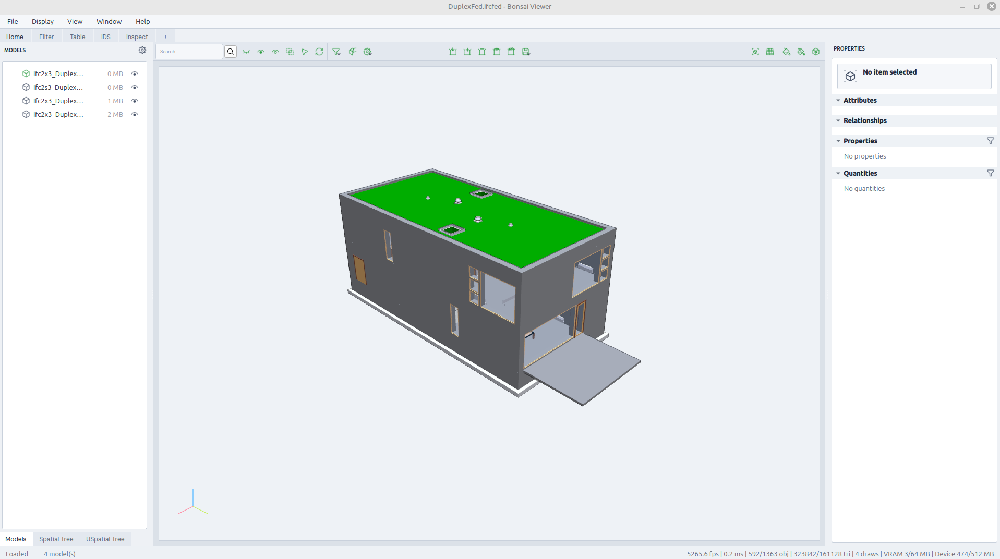

**It's made with IA.**

## Features

### Common Display

These features are **always present in the display**: they are the base of every model modification. All of them are exposed in the **Menu Bar** (the ribbon), one button group per family.

- **Hide, Show and Isolate**: driven by the selection — hide the selected elements, isolate them (hide everything else), show everything again, invert the visibility.
- **Cut plane**: section planes to cut the model open and inspect what is inside.
- **Box**: This allow to save some objects to construct complex gathering of objects.
- **Color**: paint elements with a colour, or restore their original style.

### A Search bar
You don't know where to search, and you don't know exactly what you are looking for ! That's the perfect place.
It allows to dig in the models and find your interessting data. 

### Filters

Filter rules to analyse the model: selections built from **IDS facets** (class, property, attribute, classification, material, part of), organized in **layers**, and **actions** applied to the result — isolate, add to or remove from the view, colour, transparency, automatic colour, activate/deactivate. Filters are saved between sessions and can be imported and exported as JSON files.

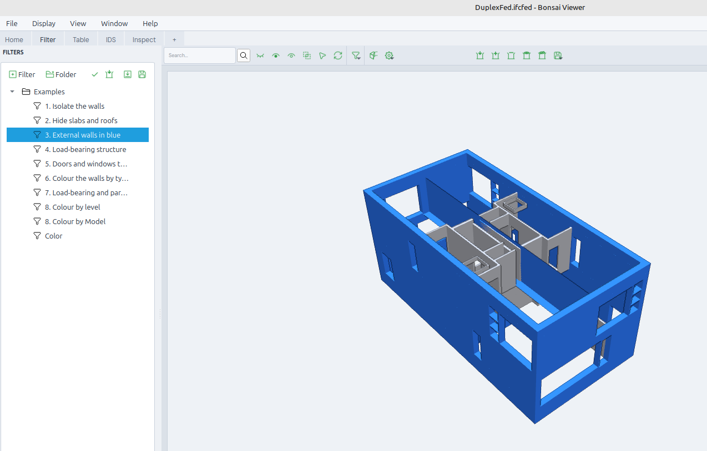

You can display data as a color. It allow a better vizualisation of data.

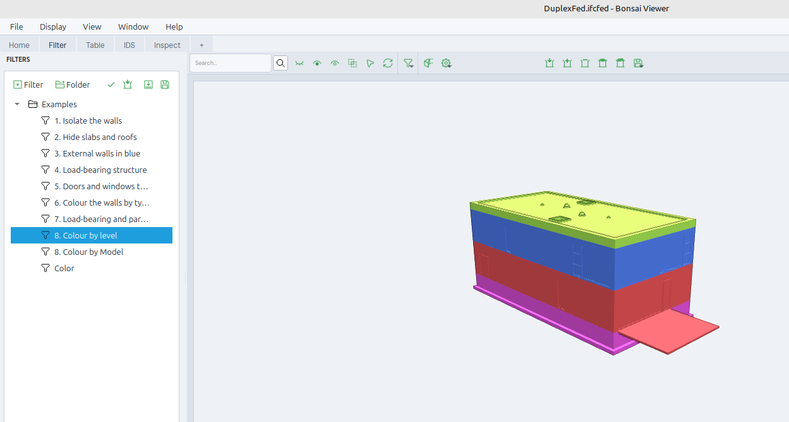

### Tables

Tables of elements, opened by the tools that produce them: values and counts of a property, colours of an automatic colour, results of a filter. The Table panel shows them even when hidden, and they can be browsed and exported.

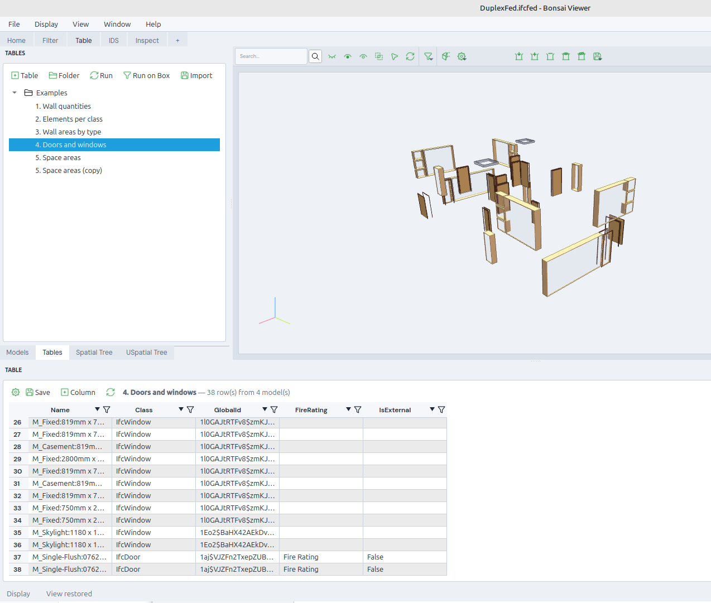

You can do small pivot table that can interact with the 3D viewer.

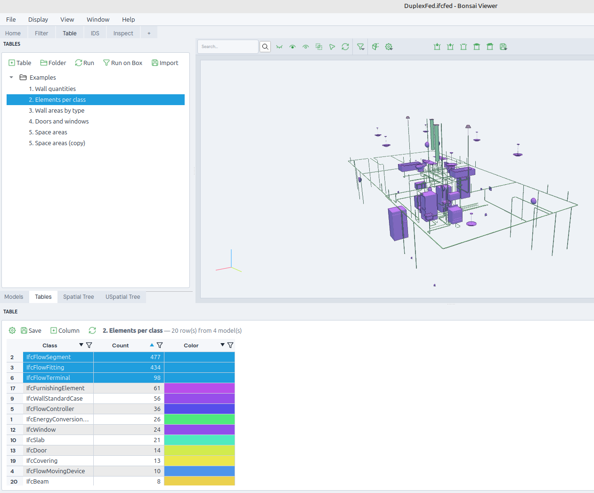

### Ifc Digger

A microscope on the IFC file itself: explore the raw structure of the model — the spatial hierarchy, the entities, their attributes, relationships and properties. For exploring and learn the Ifc file with a graphic views. 

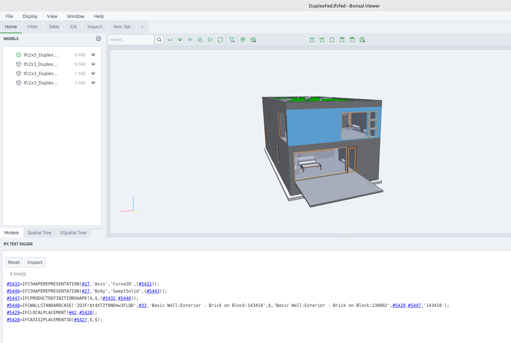

### Custom Layer
You can create your own custom windows, to display it as you like.

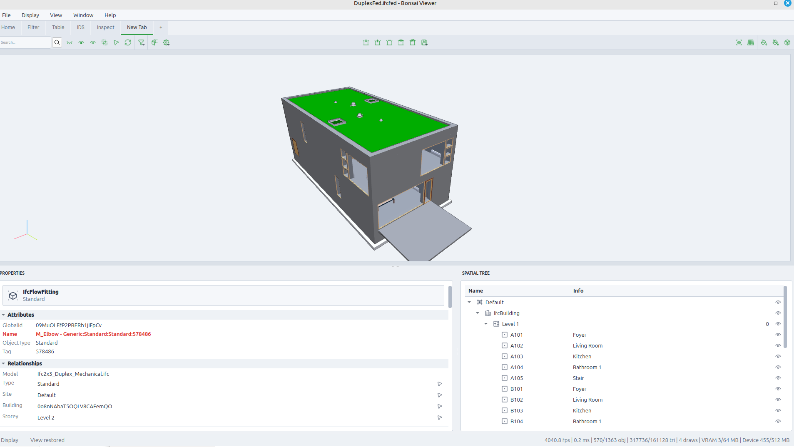

### IDS
It can create an IDS specification, modify it, and launch it on the loaded models.
The results drive both the view and the Properties panel: colour the objects by IDS result, colour the properties in the panel by their result, and filter the properties to keep only the ones the IDS selects.

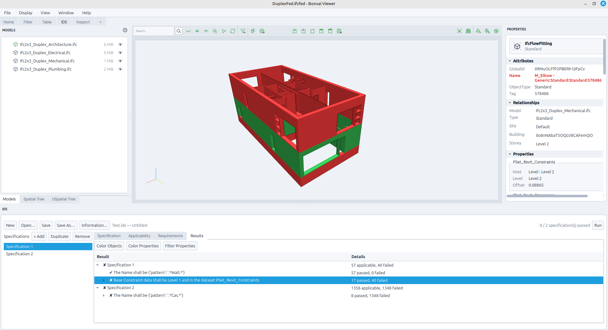

## Clash Management

Detect clashes between the loaded models with rules running on a C++ engine, directly on the parsed IFC files — including federated models loaded from `.rdb`. Results are listed with short IDs, can be triaged with verdicts (Must / Set aside) and saved in the federation for later sessions.

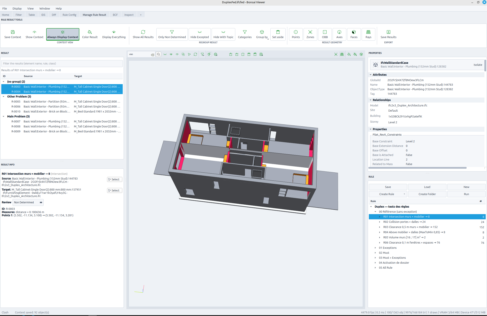

## Local BCF

Turn clash results into **BCF topics** from the Result menu: each topic gets a viewpoint with a snapshot, and every result keeps its ID in both the list and the BCF file. Topics are saved locally in a BCF file, with a prompt to save before closing.

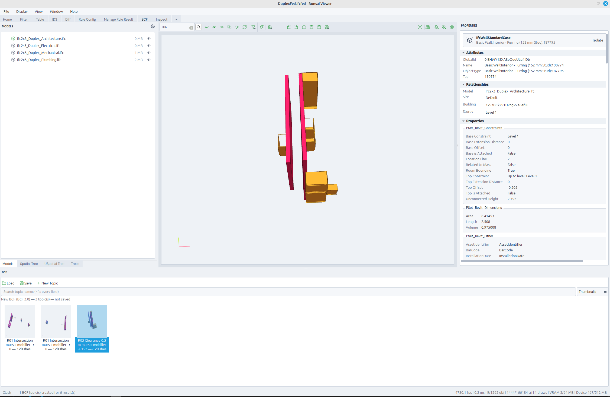

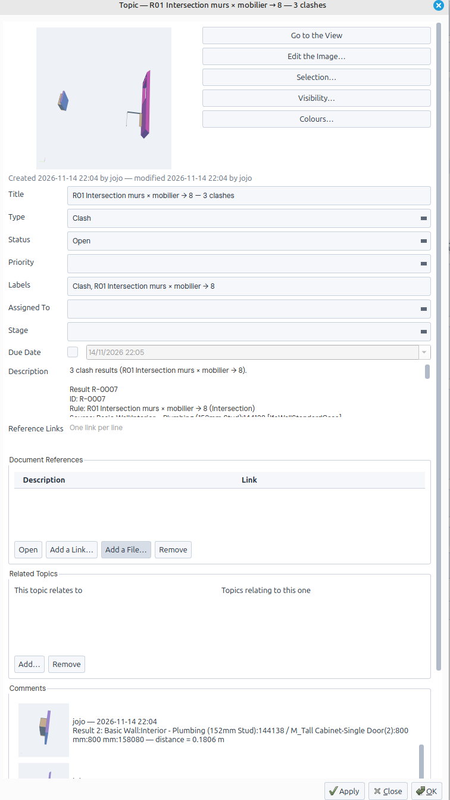

## Optimisation for big project, mass convert to RDB

This function will help for small computer or big project.
Bonsai Viewer PLUS is built to federate huge models fast. Bonsai Viewer is converting while displaying the file. It takes some RAM and for smaller config, it's better to convert, then to open them.
Baking uses several cores, mass conversions to `.rdb` run on a worker pool (with a benchmark tool to measure them), and exports and comparisons stream data block by block instead of loading whole files in memory.

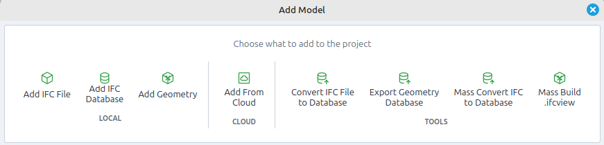

## What's New

This release brings the biggest additions to Bonsai Viewer PLUS yet.

### Clash Management
Clash rules now run on a C++ clash engine, directly on the parsed IFC files — including federated models loaded from `.rdb`. Results are serialized, can be saved in the federation, triaged with verdicts (Must / Set aside) and exported.

### Local BCF
Create BCF topics from clash results, with viewpoints, snapshots and result IDs linked back to the 3D view. You are prompted to save the BCF file before closing.

### Trees panel
A new panel gathers the model trees of every loaded model into a single unified tree, with lazy loading, visibility toggles and multi-selection.

### Performance on large projects
Multi-core baking, worker-pool mass conversions to `.rdb` with a dedicated benchmark, streaming exports and indexing optimizations make federating huge models smoother than ever.

## What's Next

### Improve BCF
The BCF module in place only create a BCF localy. I plan to able to connect to BCF server.

### Add Drawing PDF and DXF or DWG
I want to be able to overlay 2D images (drawing, etc..) in the 3D viewer.

### Calculation in table
We could do some small calculation in the viewer, multiply, add to value together. Nothing to fancy, but it could save a small step from export, going to excel and correct the export.

### Draw small chart
After the table, i could create a smalls charts about the models.

### BSDD Manage
There is probably something to do with the BSDD in here.