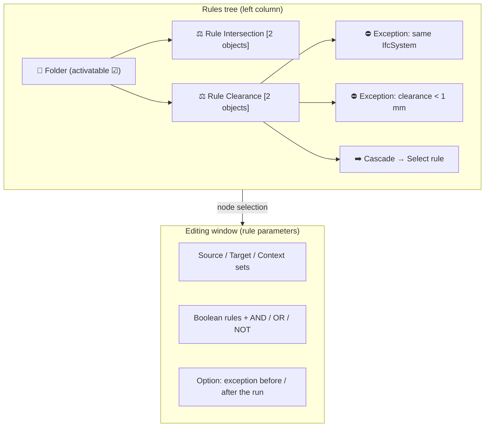

# BonsaiViewer09 - Clash Management

## Introduction

**IfcClash Plus** extends IfcClash with a **catalogue of geometric rules**, built on three goals: check the **quality** of the models (finer rules, fewer false positives to sort by hand), **select** objects on geometric criteria — where IDS only selects on properties — and **standardise** geometric validation, where the clash tools are not aligned and IDS already unifies the textual side.

Its building blocks:

- **Rules** in three classes — **one object**, **two objects**, **complex** — fed by named **Source / Target / Context sets**, the objects selected with **IDS facets**;
- **Select rules and cascades**: every rule can output a list of objects that feeds another rule, so simple rules compose into complex checks;
- **Folders** of rules, **activatable / deactivatable**, so several hundred rules stay organized and condition their own execution;
- **Exceptions**: boolean sub-rules (`have_result`, `have_less`, …, combinable with AND/OR/NOT) evaluated on the A/B pairs of the two-object rules, to discard the special cases;
- **Must rules**: absolute or relative checks on grouped results;
- **Result management**: grouping, categorisation (actor, criticality) and **BCF**.

The **Rules panel** brings this rule management into the viewer, like the Filters and Tables panels. The data model is hierarchical — folders and sub-folders, activation-conditional rules, Source→Target cascades — so the **tree is the backbone of the interface**, mirroring the rule file; and the many parameters of an exception (boolean condition, operators, timing) deserve a **dedicated window, anchored to a rule**. An exceptions window without the tree loses its context ("which rule am I excepting?"), and a tree without an editing window cannot create exceptions precisely: **the tree is the main structure, the exceptions window its contextual editor**.

## Specification

### Panel

The panel holds a **toolbar** and the **tree** of the rules. The toolbar offers:

- **Save**: saves the rules into a **rule file in JSON**;
- **Load**: loads a rule file in JSON;
- **Create Rule**;
- **Create Folder**;
- **Run**.

A **left click on a folder** offers:

- Edit Folder
- Add Folder
- Add Rule
- Delete Folder

A **left click on a rule** offers:

- Edit Rule
- Delete Rule

### Rules tree

The tree is the left column of the panel. It holds folders, sub-folders, rules and mirrors the rule file:

- **Folders**: activatable / deactivatable with a check box; an active folder conditions the execution of the rules it contains.
- **Rules**: a **type badge** per rule (1 object / 2 objects / complex), and the **doc/test status** columns of the catalogue.
- **Cascades**: a rule Select can feed a rule located in another folder. A simple **"fed by / feeds" badge** on the nodes avoids a full graph while making the dependencies visible before a run.
- Selecting a node drives the rest of the panel; a **double click opens the editing window** of the node.

In the tree, we will have slot for source, target and context,depending of the need of the rule. 
Exception, Must Rule, Actor, etc... will only be editable Editing window and will not be shown in the tree. 

### Editing window
The window sits on the right of the tree (or opens as a modal), opened by a **double click on a node**. It shows the parameters of the selected rule:

- the **Source / Target / Context sets**;
- the **boolean rules**, with the AND / OR / NOT operators;
- for an **exception**, the window exposes the **boolean condition** (have\_result, have\_less, etc.), the operators, and the timing option from the idea box: an exception **before the run** (early filter, e.g. same IfcSystem) or **after** (post-processing of the pairs).

### Running

A **Run button per level**: a single rule, a folder, or a multiple selection. The activatable folder already conditions the execution, so a run of a folder only runs its active content.

### Exceptions: scope

The exceptions window is **only accessible from two-object rules** (constraint of the rule definition). Everywhere else it is greyed out or hidden; otherwise **orphan exceptions** would be created.

### AbsOrRel (Must rules)

The **abs or rel** verification (rule Must) processes **absolute or relative quantities** on the results of the rules. It always starts with a **grouping** of all the results; the goal is to compare the quantity, or the number of elements, in each group.

Examples:

- in every room (the grouping), exactly one extinguisher;
- for every door (the grouping), at least two spaces next to it;
- for every floor (the grouping), twice as many toilets as spaces;
- in every room (the grouping), more than 10 m² of tiles.

| Kind                        | Rule                                                                                                                                                     | Applies to                     |
| --------------------------- | -------------------------------------------------------------------------------------------------------------------------------------------------------- | ------------------------------ |
| Absolute number of elements | once grouped, each group must hold **X elements** (e.g. two doors per floor); the relation may come from the source                                      | source **or** target, not both |
| Relative number of elements | the number of source elements must be **X times** the number of target elements (e.g. at least twice as many chairs as tables in every room)             | source **and** target          |
| Absolute quantity           | a quantity stored in a **property**, summed over the results of a rule by group (e.g. the window area of a room)                                         | source **or** target, not both |
| Relative quantity           | the quantity is relative between the source and the target; a relation links the two quantities (the sum of set A must be greater than the sum of set B) | source **and** target          |

## Open Subjects

- A **clickable prototype** of the interface (tree + exceptions window) to validate the concept before implementing it in Qt/Bonsai.

- **Cascades across folders**: the "fed by / feeds" badge is the proposed answer; a dependency view could replace it if the badge is not enough.
- **Left click vs right click**: the menus of the nodes are on the left click in these notes; the Filters and Tables panels use right-click context menus. To confirm.

