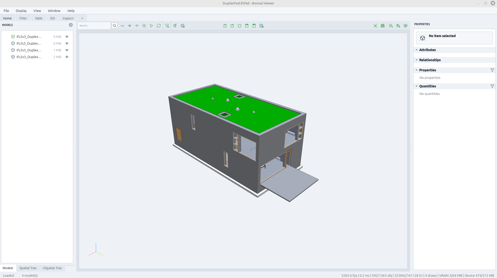
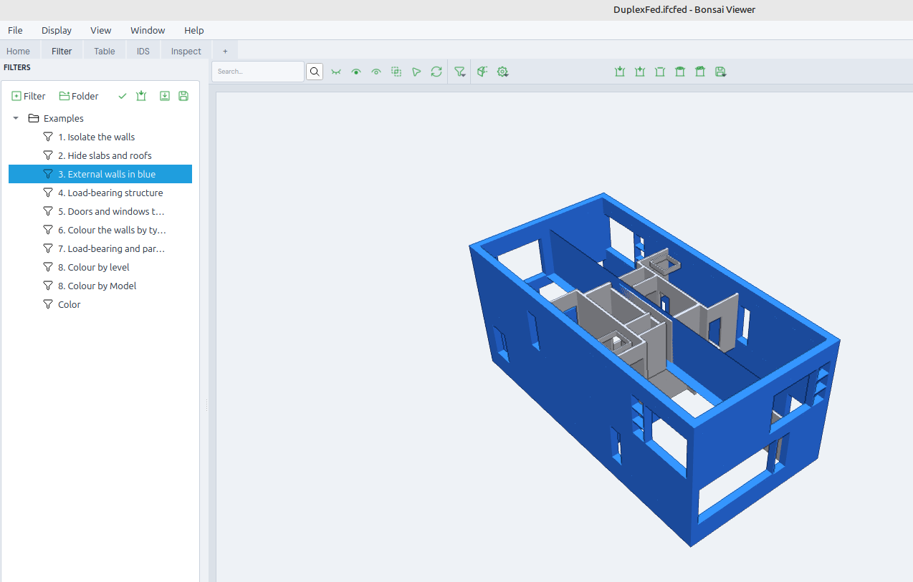
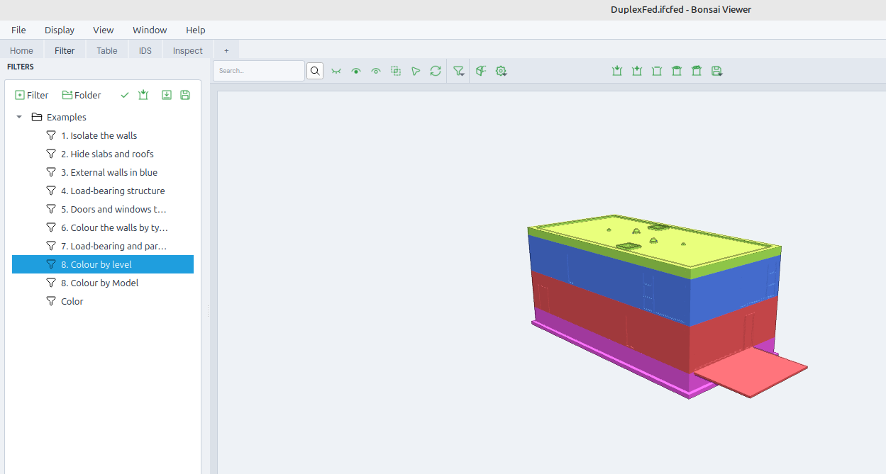
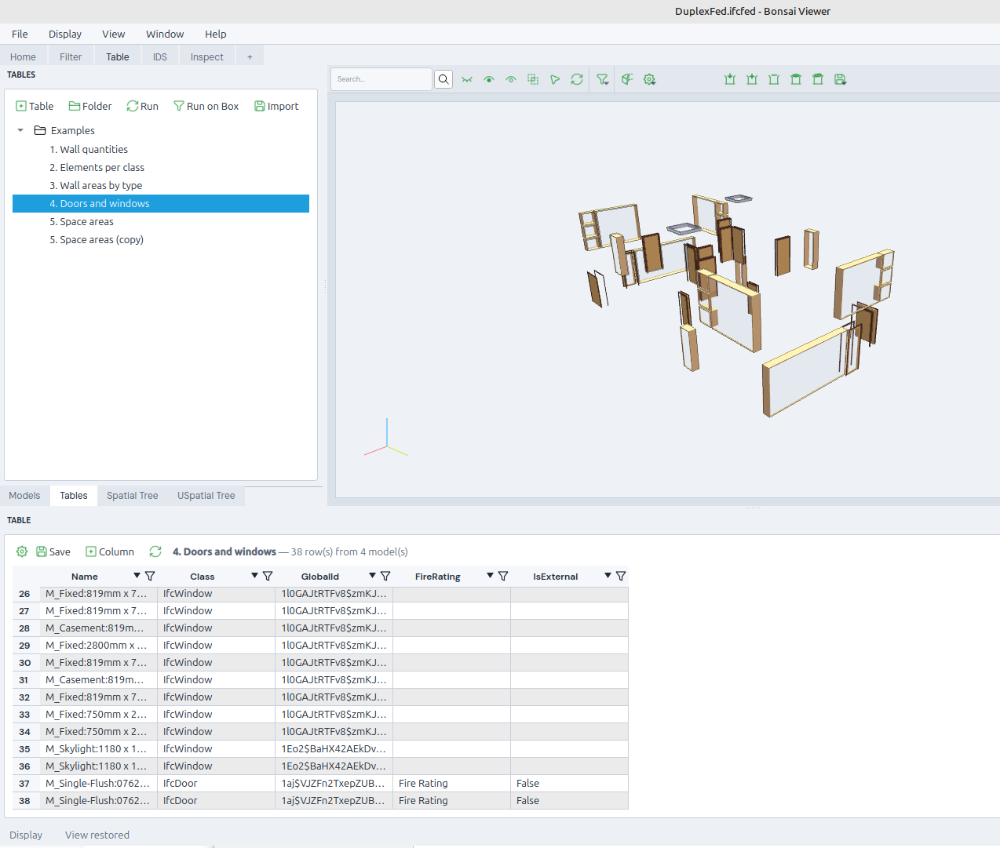
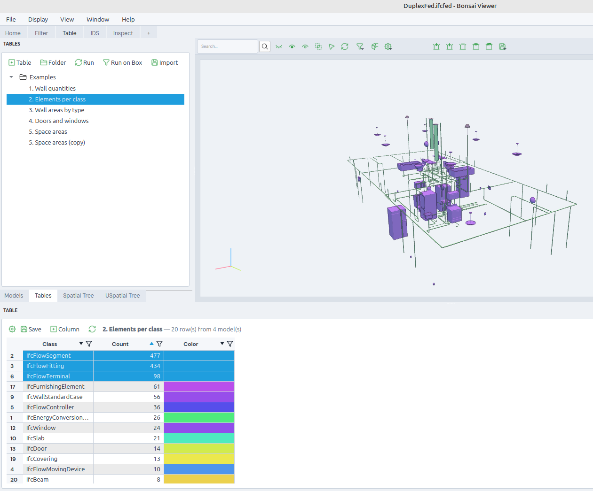
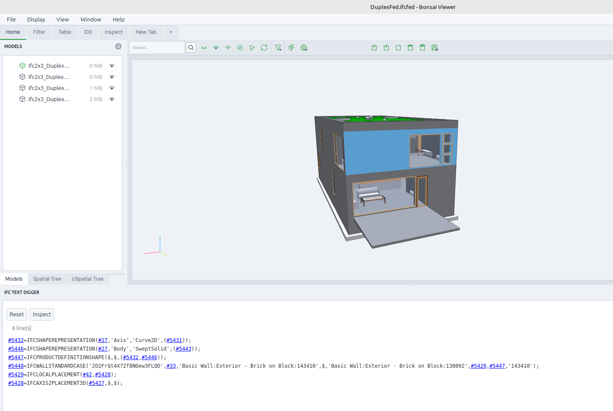
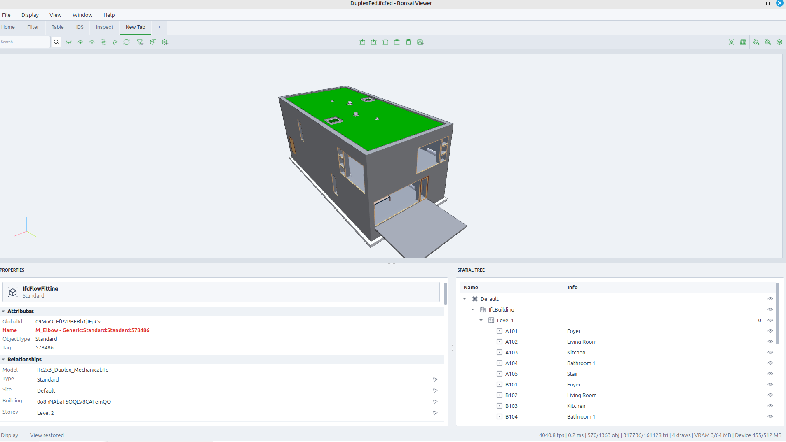
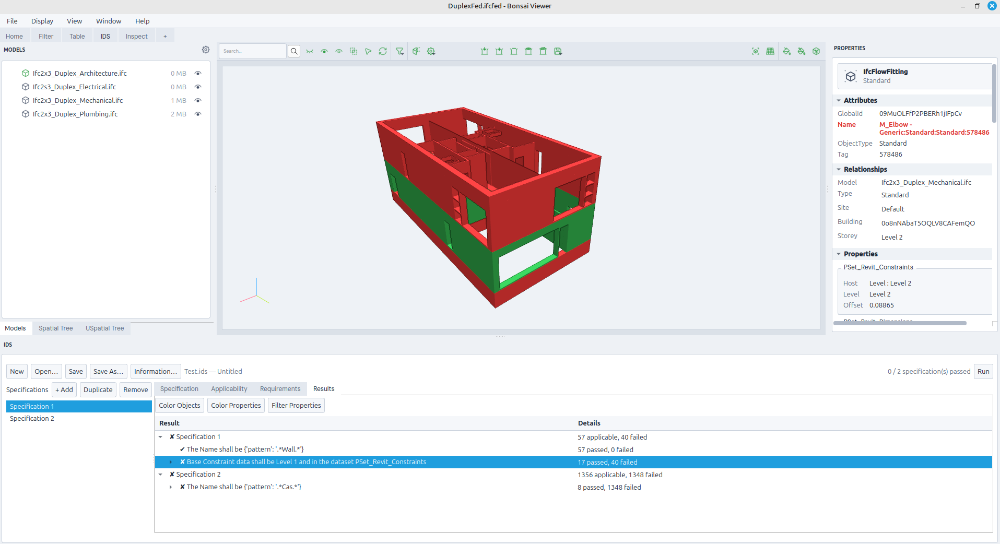

# Bonsai Viewer PLUS

Welcome to **Bonsai Viewer PLUS**, it's a community build from **Bonsai Viewer**.

It opens IFC models in seconds, federates several models in one view, and offers the tools of a coordination meeting — without any authoring environment. PLUS ships with **Filters and Tables as default features**, on top of the common display tools.

## Features

### Common Display

These features are **always present in the display**: they are the base of every model modification. All of them are exposed in the **Menu Bar** (the ribbon), one button group per family.

- **Hide, Show and Isolate**: driven by the selection — hide the selected elements, isolate them (hide everything else), show everything again, invert the visibility.
- **Cut plane**: section planes to cut the model open and inspect what is inside.
- **Box**: This allow to save some objects to construct complex gathering of objects.
- **Color**: paint elements with a colour, or restore their original style.

### A Search bar
You don't know where to search, and you don't know exactly what you are looking for ! That's the perfect place.
It allows to dig in the models and find your interessting data. 

### Filters

Filter rules to analyse the model: selections built from **IDS facets** (class, property, attribute, classification, material, part of), organized in **layers**, and **actions** applied to the result — isolate, add to or remove from the view, colour, transparency, automatic colour, activate/deactivate. Filters are saved between sessions and can be imported and exported as JSON files.

You can display data as a color, on display it clearly.

### Tables

Tables of elements, opened by the tools that produce them: values and counts of a property, colours of an automatic colour, results of a filter. The Table panel shows them even when hidden, and they can be browsed and exported.

### Ifc Digger

A microscope on the IFC file itself: explore the raw structure of the model — the spatial hierarchy, the entities, their attributes, relationships and properties. For exploring and learn the Ifc file with a graphic views. 

### Custom Layer

Create your own display

### IDS

Create IDS
Modify IDS
Launch IDS

Color object by IDS result 
Color properties by IDS result
Filter properties by IDS

## What's Next

BCF

A better tree management system

Clash

Calculation in table
We could do some small calculation in the viewer, multiply 
